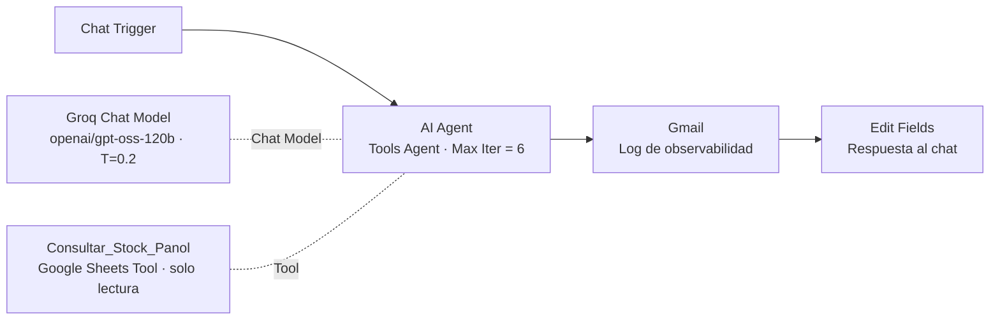

# Asistente de Pañol — Proyecto Integrador · Checkpoint M1

**Curso IA Avanzada (n8n) · Módulo 1: Agentes Autónomos vs. Automatización Lineal**
Autor: Mario Suarez · Archivo entregable: [`checkpoint1_Mario_Suarez.json`](./checkpoint1_Mario_Suarez.json)

---

## 1. Resumen

Agente autónomo en n8n que atiende consultas del **Pañol de Repuestos** de una planta industrial (personal de Mantenimiento y Producción). Interpreta consultas en lenguaje natural, consulta el maestro de stock en Google Sheets, informa disponibilidad, ubicación y criticidad, y **escala a un responsable humano** los casos fuera de su alcance o de riesgo operativo. Cada ejecución envía un **log de auditoría** por Gmail con el razonamiento y las llamadas a herramientas.

Es la **versión 1 del proyecto integrador**: en los próximos módulos se le suman orquestación multi-agente (M2), memoria (M3), integraciones (M4), RAG con manuales técnicos (M5) y voz para uso en planta (M6).

## 2. Arquitectura

| Componente obligatorio | Implementación |
|---|---|
| Disparador | `When chat message received` (Chat Trigger) |
| AI Agent | Nodo AI Agent v3.1 — modo Tools Agent (único modo desde n8n 1.82) |
| Modelo de lenguaje | Groq Chat Model · `openai/gpt-oss-120b` · Temperature 0.2 |
| Guardrail de iteraciones | **Max Iterations = 6** |
| System Prompt modular | Rol → Ámbito (incluye prohibiciones) → Objetivo → Reglas de Tools → Escalamiento → Estilo |
| Herramienta | `Consultar_Stock_Panol` — Google Sheets Tool, operación *Get Row(s)*, conectada al puerto **Tool** del agente, con *Tool Description* manual extensa |
| Observabilidad | Gmail (HTML) con consulta, respuesta y `intermediateSteps` (herramienta, input, log, observación) |

## 3. Decisiones de diseño

| Decisión | Justificación |
|---|---|
| **Groq + `gpt-oss-120b`** en lugar de GPT-4o | Nodo nativo en n8n, baja latencia y soporte de *tool calling*. Se priorizó **fidelidad estructural**, el mismo criterio que el curso asigna a GPT-4o. Temperature 0.2 para minimizar variabilidad. |
| **Max Iterations = 6** | Una consulta típica requiere: razonamiento → 1–2 llamadas a la tool → respuesta (≤ 4 vueltas). Se deja margen sin exponer el presupuesto a bucles. |
| **Herramienta de solo lectura** | Principio de **mínimo privilegio**: el agente no puede modificar, reservar ni dar de baja stock. Toda acción transaccional se escala a un humano. |
| **Tool sin filtros** (devuelve el maestro completo) | El filtro nativo de Sheets es por coincidencia exacta y no resuelve consultas coloquiales ("la goma de la bomba"). Con ~25 registros el costo en tokens es marginal. Se reemplaza por consulta filtrada en M4. |
| **Escalamiento explícito** | Criticidad A sin stock (riesgo de parada de línea), retiros/reservas/bajas, precios/proveedores/plazos y fallas reiteradas de la tool → respuesta fija de derivación al Responsable de Pañol. |
| **Return Intermediate Steps** activo | Permite auditar en el log qué herramienta se llamó, con qué input y qué devolvió (trazabilidad del ciclo ReAct). |
| **Nodo Edit Fields final** | El Chat Trigger devuelve la salida del último nodo; sin este paso el usuario vería la respuesta de Gmail en lugar de la del agente. |
| Sin memoria en M1 | La memoria se incorpora en M3 (Airtable por Session_ID). En pruebas se verificó que una memoria temporal contaminaba los resultados con historial previo. |

## 4. Pruebas y evidencia (ejecución manual)

Cada prueba se ejecutó en una sesión de chat nueva. Evidencia: log de ejecución de n8n + correo de observabilidad.

| # | Consulta | Tool | Resultado | Estado |
|---|---|:---:|---|:---:|
| 1 | ¿Tenemos goma muelle N°53 para la bomba? | 1 | 604187 · 3/4 UN → BAJO MÍNIMO · Est. A-01-04 · reposición con Compras | ✅ |
| 2 | ¿Hay juntas clamp? | 1 | Lista resumida (código + descripción) y pide confirmación antes de dar stock | ✅ (ver limitación L1) |
| 3 | ¿Qué repuestos hay para la Envasadora 2? | 1 | Listado compacto de 4 ítems con stock y estado | ✅ |
| 4 | Necesito el kit neumático D75 | 1 | Criticidad A sin stock → escala al Responsable de Pañol | ✅ |
| 5 | Retirame 2 curvas de 90° de 25,4 mm | 0 | Escala: retiro fuera de alcance (sin consultar la planilla) | ✅ |
| 6 | ¿Cuánto cuesta el variador WEG CFW500? | 0 | Escala: precios fuera de alcance | ✅ |

**Iteración de mejora documentada:** en la primera corrida, la prueba 3 listó todos los ítems con detalle completo, contradiciendo la regla de "máximo 3 opciones". Se diagnosticó que la regla no distinguía *identificación de un repuesto* de *listado por equipo*; se separó en reglas 3 y 3b y la re-prueba resultó conforme.

## 5. Limitaciones conocidas y próximos pasos

| ID | Limitación | Plan |
|---|---|---|
| L1 | La coincidencia semántica es amplia: ante "juntas clamp" incluye una "unión doble clamp". | M4: pre-filtrado determinista (sub-workflow) antes del juicio del agente. |
| L2 | La tool devuelve el maestro completo; no escala a miles de registros. | M4: consulta filtrada / sub-workflow con parámetros. |
| L3 | Sin memoria conversacional entre turnos. | M3: memoria por Session_ID en Airtable. |
| L4 | El estado "en mínimo" (actual = mínimo) se clasifica como OK. | Validar política de reposición con el área y ajustar la regla. |

## 6. Cómo importar

1. En n8n: **Workflows → Import from File** → `checkpoint1_Mario_Suarez.json`.
2. Asignar credenciales propias: Groq API, Google Sheets OAuth2, Gmail OAuth2 (no se incluyen en el export).
3. En `Consultar_Stock_Panol`, seleccionar una planilla con la pestaña `Stock` y las columnas: `Codigo_SAP, Descripcion, Equipo_Asociado, Ubicacion, Stock_Actual, Stock_Minimo, Unidad, Criticidad, Ultimo_Movimiento`.
4. En Gmail, configurar el destinatario del log.
