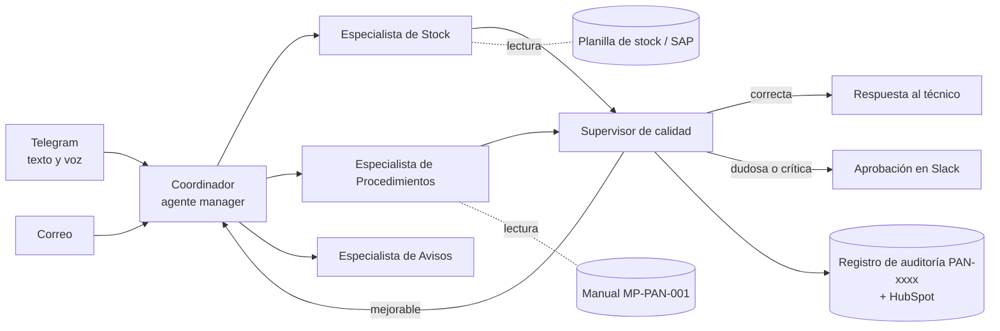

# Asistente de Pañol: Proyecto Integrador · Pre-entrega M10

**Curso IA Avanzada (n8n) · Módulo 10: Brochure técnico-comercial y defensa ante comité**
Autor: Mario Suarez · Entregable: [`PreEntrega_Modulo10_MarioSuarez.pdf`](./PreEntrega_Modulo10_MarioSuarez.pdf)
Base: arquitectura Manager-Worker del [M2](../M2), diseño vertical y semáforo de riesgo del [M7](../M7), supervisor AI-as-a-Judge del [M8](../M8) y baseline, TCO y ROI del [M9](../M9)

---

## 1. Resumen

El brochure presenta el sistema construido en el curso como una propuesta de servicio para el Pañol de Repuestos de Grupo DISAL (Planta Villa Mercedes). Está escrito en lenguaje de negocio para que lo entienda y lo apruebe un comité directivo no técnico.

| Indicador | Valor |
|---|---|
| Baseline manual (M9) | 550 consultas/mes = 36,3 h hombre |
| Horas liberadas | 25,4 h/mes (70 % del tiempo de consultas) |
| ROI de la solución (M9) | 130 % operada con recursos propios |
| Modelo comercial | Fee US$ 900 + retainer US$ 60/mes + US$ 0,10 por consulta resuelta (tope US$ 50/mes) |
| ROI con el modelo comercial | 71 % base · 21 % conservador · 80 % meta |
| Payback del fee | 4,6 meses base (8,2 conservador · 4,1 meta) |
| Ventana de conversión | 2 días corridos desde la última interacción del asistente |
| Pedido al comité | Piloto de 30 días en modo sombra (26/10 al 24/11/2026) |

## 2. Contenido del PDF (8 páginas)

| Sección | Peso | Contenido |
|---|---|---|
| 1 · Narrativa ejecutiva y arquitectura de valor | 35 % | Problema y promesa, diagrama de la capa de orquestación (coordinador, 3 especialistas, supervisor de calidad y 6 herramientas), traducción Función → Beneficio de 10 capacidades, business case del M9 y payback en 3 escenarios |
| 2 · Roadmap por horizontes temporales | 25 % | Fases 0 a 3 (sombra, solo lectura, escritura con aprobación humana, autonomía supervisada) con qué puede hacer, qué tiene prohibido, quién valida, criterio de salida y riesgo que mitiga; fallback en 5 niveles |
| 3 · Modelo comercial e incentivos | 20 % | Pricing híbrido con alcance de cada componente, KPI facturable "consulta resuelta", ventana de conversión y nivel de servicio del retainer |
| 4 · Implementación y control de metadatos | 20 % | 8 hitos a 30 días con fecha y responsable por rol, registro por consulta en HubSpot como única fuente de verdad para facturar y defensa de 3 objeciones |

## 3. Arquitectura de valor

## 4. Roadmap de despliegue

| Fase | Horizonte | Qué habilita | Criterio de salida |
|---|---|---|---|
| 0 · Modo sombra | Mes 1 | Propone; el pañolero decide | ≥ 200 consultas, ≥ 80 % de propuestas aceptadas, 0 errores sin detectar |
| 1 · Solo lectura | Meses 2–3 | Responde stock y procedimientos con cita | Precisión ≥ 90 %, derivación ≤ 30 %, satisfacción ≥ 85 % |
| 2 · Escritura con aprobación humana | Meses 4–5 | Prepara solicitudes de retiro; una persona aprueba | ≥ 95 % aprobadas sin edición, 0 acciones sin aprobación |
| 3 · Autonomía supervisada | Desde el mes 6 | Resuelve solo lo verde (puntaje < 20) | Se mantiene sin caída > 5 puntos; un error crítico vuelve a la Fase 2 |

> Los valores marcados en el PDF como **MEDIDO** provienen de las pruebas del M8; los marcados como **SUPUESTO** se validan en la auditoría de procesos de la semana 1. Los precios del modelo comercial son la propuesta de esta entrega.
