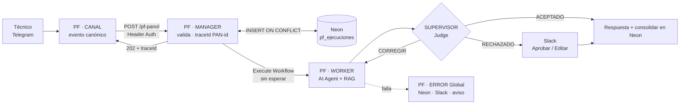

# Asistente de Pañol: Proyecto Integrador · Proyecto Final (M11)

**Curso IA Avanzada (AI Experto) · Cohorte 2026 · Comisión 97490 · Proyecto Final (DMSA)**
Autor: Mario Suarez · Entregable: [`Suarez_Mario_ProyectoFinal_AI_Experto.pdf`](./Suarez_Mario_ProyectoFinal_AI_Experto.pdf) (16 páginas)
Base: Manager-Worker del [M2](../M2), memoria del [M3](../M3), RAG del [M5](../M5), voz del [M6](../M6), supervisor AI-as-a-Judge del [M8](../M8) y gobernanza, TCO y ROI del [M9](../M9)

---

## 1. Resumen

Sistema multiagente asincrónico desplegado en n8n: un técnico consulta stock o procedimientos del pañol de repuestos por Telegram y recibe en segundos una respuesta sustentada en el dato oficial o en la sección exacta del manual. Un Juez LLM audita cada respuesta antes de que salga, y lo dudoso o riesgoso pasa a una persona en Slack. El nombre de la empresa se reserva.

| Indicador (pruebas del 10 y 11/11/2026) | Valor |
|---|---|
| Lead time de respuesta (mediana) | 16,4 s, contra 4 min de la consulta manual (−93 %) |
| Acuse con traceId (webhook → HTTP 202) | 0,7 s |
| Respuestas incorrectas entregadas | 0 · 12 de 12 respuestas verificadas fueron correctas |
| Costo de IA por consulta (agente + Juez) | US$ 0,00113 medido · US$ 0,62/mes para 550 consultas |
| ROI de la operación propia (M9) | 130 % · payback de 3,8 meses |

## 2. Contenido del PDF

| Sección | Contenido |
|---|---|
| 1 · Resumen ejecutivo | Desafío, solución, resultados, stack, decisión pedida con criterios de seguir, ajustar o detener; KPIs antes y después |
| 2 · Arquitectura | Diagrama con el recorrido del traceId, 4 workflows con contratos, capturas de las ejecuciones reales, idempotencia, persistencia, máquina de estados y pruebas T0–T9 |
| 3 · Auditoría del Juez | Rúbrica y esquema JSON, tabla de rutas y umbrales, 3 JSON reales (ACEPTADO, CORREGIR → ACEPTADO, RECHAZADO → aprobación humana), resultados y calibración pendiente |
| 4 · ROI | Tokens vs. horas de trabajo, lead time antes y después, titular del M9 validado con datos medidos, puente con el M10 y sensibilidad |
| Anexos | Stack y credenciales (solo nombres), esquema de Neon, gobernanza y retención, hallazgos H1–H5 y roadmap |

## 3. Arquitectura

| Requisito | Dónde se cumple |
|---|---|
| Webhook que responde de inmediato y procesa en segundo plano | Manager: HTTP 202 con traceId en 0,7 s; el Worker corre en otra ejecución |
| Nada se consolida sin pasar por el Juez | "Consolidar registro" está después de "Respuesta supervisada", única salida del Juez |
| Reintentos y fallas sin duplicar | `event_id` único en Neon: un duplicado devuelve HTTP 200 con el traceId original (T5) |
| Ramas de error ante caídas de APIs | PF · ERROR Global: estado `error`, alerta en Slack con Ref y aviso al usuario (T6); reproceso único (T6b) |
| Seguridad | Header Auth (403 sin clave), credencial restringida a `localhost`, secretos solo en Credentials de n8n |

> Los valores marcados en el PDF como **MEDIDO** provienen de las ejecuciones reales del 10 y 11/11/2026 (Neon `pf_ejecuciones` y Google Sheets `Log_Juez_M8`); los marcados como **SUPUESTO** se validan en el piloto. El documento no contiene claves ni tokens.
