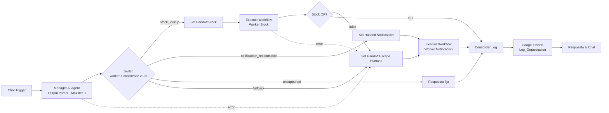

# Asistente de Pañol: Proyecto Integrador · Checkpoint M2

**Curso IA Avanzada (n8n) · Módulo 2: Orquestación Multi-Agente Distribuida (patrón Manager-Worker)**
Autor: Mario Suarez · Entregable: [`preentrega_modulo2_suarez_mario.pdf`](./preentrega_modulo2_suarez_mario.pdf)
Flujos: [`manager_modulo2_suarez_mario.json`](./manager_modulo2_suarez_mario.json) · [`worker1_modulo2_suarez_mario.json`](./worker1_modulo2_suarez_mario.json) · [`worker2_modulo2_suarez_mario.json`](./worker2_modulo2_suarez_mario.json)

---

## 1. Resumen

Evolución del agente del M1 hacia una **red modular de tres workflows**. Un **Manager** interpreta la intención del usuario dentro de una taxonomía cerrada y delega, mediante el nodo **Execute Workflow** (*Wait for completion* ON), en dos **Workers** especialistas:

- **Worker Stock Lookup:** es el agente del M1 encapsulado. Consulta el maestro de stock en solo lectura.
- **Worker Notificación Responsable:** redacta y envía el aviso al Responsable de Pañol. Se reutiliza para las derivaciones y para el escape humano.

Cada delegación usa un **contrato de datos JSON** explícito, y cada ejecución queda registrada en un **log de trazabilidad** en Google Sheets.

## 2. Arquitectura



| Workflow | Rol | Conectores |
|---|---|---|
| Manager Asistente Pañol – M2 | Orquestador: interpreta, delega, consolida y registra | Groq `gpt-oss-20b` · Google Sheets (log) |
| Worker Stock Lookup – M2 | Especialista de lectura | Groq `gpt-oss-120b` · Google Sheets (solo lectura) |
| Worker Notificacion Responsable – M2 | Especialista de redacción y aviso | Groq `gpt-oss-120b` · Gmail |

## 3. Contrato de datos

**Handoff (Manager → Worker):** Set con JSON mínimo, sin historial, metadatos ni binarios.

| Campo | W. Stock | W. Notificación |
|---|:---:|:---:|
| `intent`, `request`, `original_input`, `confidence`, `session_id` | ✔ | ✔ |
| `codigo_sap`, `material_query` | ✔ | — |
| `motivo` | — | ✔ |

**Retorno (Worker → Manager):** misma estructura en éxito y en error.

```json
{ "status": "success | not_found | out_of_scope | error",
  "worker": "stock_lookup",
  "params": { "...eco de lo recibido..." },
  "data": { "respuesta": "...", "...": "..." },
  "error_message": "" }
```

## 4. Criterio de enrutamiento

| Worker | Intenciones | Acción |
|---|---|---|
| `stock_lookup` | `stock_disponibilidad`, `stock_ubicacion`, `stock_listado_equipo` | Automático (bajo riesgo) |
| `notificacion_responsable` | `gestion_material`, `consulta_comercial` | Derivación humana por correo |
| `unsupported` | `unsupported` | Respuesta fija, sin Workers |
| Fallback `escape_humano` | `revision_humana` | Confianza < 0,5, error del Manager, falla o `out_of_scope` del Worker de stock |

Umbrales de confianza: ≥ 0,85 automático · 0,50–0,84 se ejecuta y se marca `Requiere_Revision` · < 0,50 escape humano.

## 5. Robustez

| Riesgo (consigna) | Mitigación |
|---|---|
| Workflow mono-bloque | 3 workflows; el Manager no tiene herramientas operativas |
| Pasillo de la muerte | Set de handoff con JSON mínimo antes de cada Execute |
| Time-out | Timeout Workflow: Workers 60 s, Manager 300 s · Worker Stock con retry ×2 |
| Fallos del Worker | *On Error → Continue (error output)* → contrato `status: error` |
| Bucle entre especialistas | El Worker Stock devuelve `out_of_scope` → escala a un humano, no re-deriva |

## 6. Pruebas (testing de regresión)

| # | Mensaje | Ruta | Estado |
|---|---|---|:---:|
| 1 | ¿Tenemos goma muelle N°53 para la bomba? | stock_lookup (0,95) | ✅ |
| 2 | Retirame 2 curvas de 90° de 25,4 mm | notificacion_responsable (0,95) + correo | ✅ |
| 3 | Hola, buen día | unsupported (tras recalibrar `confidence`) | ✅ |
| 4 | lo de ayer | unsupported: pide aclaración | ✅ aceptado |
| 5 | Consulta 1 con el LLM del Worker caído | error → escape humano + correo `revision_humana` | ✅ |

## 7. Lecciones aprendidas

- **Confianza mal calibrada:** un saludo clasificado con 0,3 iba al escape humano. Se redefinió en el prompt que la confianza mide la certeza de la clasificación, no si el pedido es resoluble.
- **Tipos en el handoff:** `confidence` llegaba como 0 al Worker. Se resolvió con *Attempt To Convert Types* en Execute Workflow.
- **IDs de sub-workflow:** cambian al importar. Hay que volver a seleccionar el Worker *From list*.
- **Zona horaria:** configurar `America/Argentina/Buenos_Aires` en los 3 workflows.
- **Chat en Markdown:** usar `replace(/\n/g, '  \n')` para conservar los saltos de línea.

## 8. Cómo importar

1. Importar primero los Workers y después el Manager (**Import from File**). Publicar los Workers.
2. Asignar credenciales propias: Groq, Google Sheets OAuth2 y Gmail OAuth2.
3. Crear en la planilla la pestaña `Log_Orquestacion` con estos encabezados: `Fecha, Session_ID, Consulta, Intent, Confianza, Requiere_Revision, Worker, Parametros_Enviados, Status, Respuesta, Error`.
4. En los nodos *Ejecutar Worker*, volver a seleccionar el sub-workflow correspondiente *From list*.
5. En el Worker de Notificación, configurar el destinatario del correo.
