# Asistente de Pañol: Proyecto Integrador · Checkpoint M3

**Curso IA Avanzada (n8n) · Módulo 3: Memoria, Estado y Conocimiento (persistencia híbrida y resumen agéntico)**
Autor: Mario Suarez · Entregable: [`PreEntrega_Modulo3_Suarez_Mario.pdf`](./PreEntrega_Modulo3_Suarez_Mario.pdf)
Flujo: [`manager_modulo3_suarez_mario.json`](./manager_modulo3_suarez_mario.json) · Base de corto plazo: [`neon_chat_turnos.sql`](./neon_chat_turnos.sql) · Workers: sin cambios ([M2](../M2))

---

## 1. Resumen

Sobre la arquitectura Manager-Worker del M2 se agregó una **capa de memoria híbrida** que elimina la amnesia entre ejecuciones de n8n:

- **Identidad estable:** canal Telegram; `chat.id` funciona como **Session_ID**, igual en todas las sesiones y días.
- **Memoria de largo plazo:** Airtable `Memoria_Panol`, con una ficha por usuario y upsert idempotente por Session_ID.
- **Memoria de corto plazo:** Neon Postgres `chat_turnos`, un buffer de turnos que sirve para resolver referencias, contar intercambios y alimentar el resumen.
- **Summarization:** cuando hay **más de 5 intercambios** sin resumir, `gpt-4o-mini` consolida la conversación en un JSON `{asunto_principal, puntos_clave[], accion_requerida}`.
- **Inyección blindada:** los datos recuperados entran al System Prompt del Manager entre `[INICIO DE CONTEXTO COMPARTIDO]` y `[FIN DEL CONTEXTO COMPARTIDO]`.

## 2. Arquitectura

```mermaid
flowchart LR
    T[Telegram Trigger] --> N[Normalizar Entrada<br/>session_id = chat.id]
    N --> S[Airtable Search<br/>Session_ID]
    S --> IF{¿Usuario recurrente?}
    IF -- no --> NEW[Airtable upsert<br/>alta limpia] --> C
    IF -- sí --> C[Contexto Memoria]
    C --> B[Neon: últimos 6 msg / 12 h] --> P[Preparar Contexto]
    P --> M[Manager AI Agent<br/>contexto inyectado]
    M --> W[Switch → Workers M2]
    W --> L[Log Sheets] --> R[Responder Telegram]
    R --> G[Neon: guardar turno] --> K{¿> 5 intercambios?}
    K -- sí --> SUM[gpt-4o-mini<br/>JSON estructurado] --> UP[Airtable upsert] --> MK[Neon: marcar resumidos]
    K -- no --> ST[Airtable: actualizar estado]
```

| Componente | Configuración |
|---|---|
| Manager | AI Agent (Tools Agent) · principal OpenRouter `gpt-4o-mini` · respaldo Groq `qwen/qwen3.8-27b` · retry ×2 · reglas 12–16 de uso de memoria |
| Summarization | Basic LLM Chain · OpenRouter `gpt-4o-mini` (temp. 0,1) · Structured Output Parser con JSON Schema |
| Worker Stock | Groq `gpt-oss-120b`, con cupo exclusivo (sin cambios desde M2) |
| Entorno | n8n 2.26.7 en Docker · túnel HTTPS para el webhook de Telegram · zona horaria Buenos Aires |

## 3. Esquema de datos

**Airtable `Memoria_Panol`** (largo plazo, una fila por usuario)

| Campo | Tipo | Uso |
|---|---|---|
| `Session_ID` | Texto · primario | Filtro de lectura y clave del upsert |
| `Nombre_Usuario` | Texto | Identidad inyectada |
| `Estado_Caso` | Selección única | Estado de la última solicitud (determinista) |
| `Fecha_Actualizacion` | Fecha y hora | Vigencia |
| `Resumen_Consolidado` | Texto largo | `asunto_principal` |
| `Datos_Clave` | Texto largo | `puntos_clave` |
| `Accion_Requerida` | Texto largo | `accion_requerida` |
| `Resumen_JSON` | Texto largo | Objeto JSON completo (sobrescrito) |
| `Ultimo_Intent` | Texto | Trazabilidad |

**Neon `chat_turnos`** (corto plazo): `id`, `session_id`, `role`, `content`, `resumido`, `created_at`, con índices por sesión y para los pendientes. Script: [`neon_chat_turnos.sql`](./neon_chat_turnos.sql).

## 4. Pruebas

| # | Prueba | Resultado |
|---|---|---|
| 1 | Usuario nuevo → alta limpia | ✅ |
| 2 | Consulta de stock (flujo M2) | ✅ |
| 3 | "¿Y dónde está ubicada?" → memoria de corto plazo | ✅ |
| 4 | "Necesito retirar 2 de esas" → referencia resuelta | ✅ |
| 5 | Listado por equipo | ✅ |
| 6 | Resumen al superar 5 intercambios | ✅ |
| 7 | "¿Ya aprobaron lo de ayer?" con el buffer vacío → memoria de largo plazo | ✅ |
| 8 | Aislamiento entre Session_ID | ✅ |
| 9 | Intento de inyección de instrucciones | ✅ |
| 10 | Sobrescritura sin duplicados | ✅ |

Ocho hallazgos se corrigieron durante las pruebas: robustez de modelos, cupo compartido, reglas del resumidor, intención de seguimiento, estado del caso y salida siempre en JSON. El detalle está en el anexo C del PDF.

## 5. Puesta en marcha

1. Ejecutar `neon_chat_turnos.sql` en Neon y crear la tabla `Memoria_Panol` en Airtable con los campos de la sección 3.
2. Importar `manager_modulo3_suarez_mario.json` y asignar las credenciales: Telegram, Postgres (SSL require), Airtable (PAT), OpenRouter, Groq y Google Sheets.
3. En los nodos de Airtable, elegir base y tabla *From list*. En los dos nodos Execute Workflow, volver a seleccionar los Workers del M2.
4. Exponer n8n por HTTPS (`WEBHOOK_URL`) y publicar el workflow.

> El JSON no contiene secretos: n8n exporta solo referencias a las credenciales. Los identificadores de webhook se quitaron de esta copia y se regeneran al importar.
