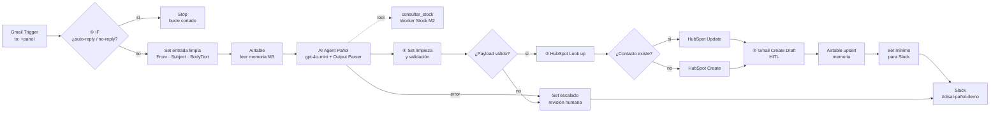

# Asistente de Pañol: Proyecto Integrador · Checkpoint M4

**Curso IA Avanzada (n8n) · Módulo 4: Integraciones Avanzadas e Interconexión de Sistemas**
Autor: Mario Suarez · Entregable: [`checkpoint4_mario_suarez.json`](./checkpoint4_mario_suarez.json)
Base: Checkpoint [M3](../M3) (memoria en Airtable) + Worker Stock del [M2](../M2), reutilizado como herramienta

---

## 1. Resumen

El Asistente de Pañol suma un **canal de solicitudes por email** conectado a tres herramientas reales del negocio, con controles preventivos no-code en el lienzo:

| Rol en el ecosistema (clase en vivo) | Herramienta | Uso en el flujo |
|---|---|---|
| Casilla de soporte | **Gmail** (OAuth2) | Entrada de solicitudes y borrador de respuesta (*Create Draft*) |
| CRM / fuente de datos del solicitante | **HubSpot** (Service Key, 3 scopes) | Lectura (Look up) y escritura (Create / Update) del contacto y su última solicitud |
| Canal del equipo | **Slack** (OAuth2) | Aviso al canal de operaciones del pañol |
| Memoria (M3) | Airtable `Memoria_Panol` | Contexto previo del solicitante y estado del caso |
| Conocimiento operativo (M2) | Worker Stock Lookup | Stock real, mínimo y ubicación, en solo lectura |

El agente **nunca envía**: redacta un borrador que el Responsable de Pañol revisa, edita y envía (*Human-in-the-loop*).

## 2. Arquitectura



## 3. Cumplimiento de la consigna

| Paso | Requisito | Implementación |
|---|---|---|
| 1 | Tres conectores nativos del stack del caso | Gmail · HubSpot · Slack (+ Airtable y Worker del proyecto) |
| 2 | Autenticación validada, conectores en verde | Gmail OAuth2 · Slack OAuth2 · HubSpot Service Key (ver 4.1) |
| 3 | Lectura y escritura con mínimo privilegio | Ver sección 4 |
| 4–5 | **① IF** posterior al trigger contra auto-respuestas | 11 condiciones en OR, sin distinguir mayúsculas: asunto (*auto-reply, automatic reply, respuesta automática, out of office, fuera de la oficina, undeliverable, delivery status notification*), remitente (*no-reply, noreply, mailer-daemon*) y encabezados RFC 3834 (*Auto-Submitted, X-Autoreply, Precedence*) |
| 6 | **② Look up** antes del Create (evita 409) | Búsqueda por email → IF → Update o Create |
| 7 | **③ Create Draft** como salida de correo (HITL) | Borrador en el mismo hilo del correo original |
| 8 | **④ Set** de limpieza antes de los conectores | Set de entrada (From · Subject · BodyText, sin historial citado, máx. 3.000 caracteres) + Set de validación (regex de email y borrador no vacío) + Set mínimo antes de Slack (resumen ≤ 280 caracteres) |
| 9 | Test de regresión antes de exportar | Sección 6 |

## 4. Credenciales y mínimo privilegio

| Conector | Autenticación | Alcance concedido | Restricción adicional |
|---|---|---|---|
| Gmail | OAuth2 (Google Cloud) | Lectura de la casilla y creación de borradores | Trigger acotado a `to:…+panol@gmail.com`; nunca *Send* |
| HubSpot | Service Key | `crm.objects.contacts.read`, `crm.objects.contacts.write`, `crm.schemas.contacts.read` | Dominio permitido: `api.hubapi.com`. Escribe solo `ultima_solicitud_panol`, `ultimo_material_panol` y nombre (solo en el alta) |
| Slack | OAuth2 (app propia por manifest) | User scopes `chat:write`, `channels:read` | Dominio permitido: `slack.com`; sin rotación de token |
| Airtable | Personal Access Token (M3) | `data.records:read/write`, `schema.bases:read`, una sola base | — |

### 4.1 Decisión de diseño: HubSpot con Service Key, no OAuth2

En n8n *self-hosted*, la credencial OAuth2 de HubSpot exige una app de la plataforma de desarrolladores nueva (configurable solo por CLI). Además, n8n solicita siempre la **lista completa de 13 scopes** del nodo (forms, tickets, deals, companies, owners, lists). Eso contradice el principio de mínimo privilegio que pide la misma consigna. Se optó por una **Service Key** (método recomendado por HubSpot frente a las *private apps*, hoy *legacy*) con **solo los 3 scopes de contactos**. Gmail y Slack usan OAuth2.

## 5. Contrato de datos

**Salida del agente (Structured Output Parser):**

```json
{
  "intent": "stock_disponibilidad | stock_ubicacion | stock_listado_equipo | gestion_material | consulta_comercial | unsupported",
  "codigo_sap": "604187",
  "material": "Goma muelle N°53",
  "cantidad": 0,
  "requiere_revision": false,
  "draft_subject": "Re: …",
  "draft_body": "Texto plano, máx. 1.200 caracteres",
  "slack_summary": "Máx. 280 caracteres",
  "contact_first_name": "Juan",
  "contact_last_name": "Perez"
}
```

**Handoff a la herramienta `consultar_stock`** (mismo contrato que el M2): `intent`, `codigo_sap`, `material_query`, `request`, `original_input` (solo la consulta de stock, sin acciones de retiro), `confidence`, `session_id`.

## 6. Pruebas

| # | Caso | Ruta esperada | Resultado |
|---|---|---|:---:|
| 1 | Consulta de stock de un repuesto | Agente + herramienta → Look up → Draft → Airtable → Slack | ✅ |
| 2 | Pedido de retiro (contacto existente) | `gestion_material`, `requiere_revision` → **Update**, sin duplicado | ✅ |
| 3 | Remitente nuevo (otra casilla) | **Create** con nombre, apellido y propiedades | ✅ |
| 4 | Segundo correo del remitente nuevo | **Update**, sigue habiendo un solo contacto (409 evitado) | ✅ |
| 5 | "Respuesta automática: Fuera de la oficina" | ① IF → **Stop**; ningún otro nodo se ejecuta | ✅ |
| 6 | Email de remitente vacío (datos fijados) | ¿Payload válido? → no → **escalado** 🚨 en Slack, sin CRM ni borrador | ✅ |
| 7 | **Regresión:** listado de repuestos de la bomba 1NEJ40 | Camino completo en verde, 1 llamada a la herramienta, parser sin reintentos | ✅ |

### Hallazgos e iteraciones

| # | Síntoma | Causa | Corrección |
|---|---|---|---|
| 1 | Consulta de stock fallida ("too many requests") | Cupo de Groq del Worker compartido entre los canales Telegram y Email, más reintentos en ráfaga del agente | Regla 2: ante `error` no se reintenta y se marca revisión humana |
| 2 | Worker devuelve `out_of_scope` ante un pedido de retiro | Se le enviaba el correo completo; el guardrail de solo lectura del Worker (M2) rechaza acciones | `original_input` = consulta de stock reformulada por el agente (mínimo contexto) |
| 3 | Timeout del Worker | El *retry* sobre un límite por minuto agotaba los 60 s | Worker: principal OpenRouter `gpt-4o-mini`, respaldo Groq, retry 2 × 2 s |
| 4 | Output Parser rechaza listados largos | Salida mayor a 900 tokens, JSON truncado | Max Tokens 2.000 + tope de 8 repuestos por listado (regla 12) |
| 5 | Saludo con el nombre de la cuenta y no del firmante | Regla de redacción ambigua | Regla 6: saludo a quien firma el correo |

En todos los casos el diseño absorbió la falla sin efectos externos: el agente no inventó stock, el borrador no se envió y los errores terminaron en revisión humana.

**Lecciones de implementación:** al reseleccionar el sub-workflow *From list*, n8n vacía los *Workflow Inputs*. Las propiedades de HubSpot se eligen de la lista, porque internamente se guardan como `nombre|tipo`. El *Debug in Editor* requiere la edición registrada, así que las pruebas de bordes se hicieron fijando datos (*pin*) en el trigger.

## 7. Limitaciones y evolución

| Limitación | Evolución |
|---|---|
| El agente se ejecuta antes de validar el email (consume tokens en payloads inválidos) | Validación previa del remitente antes del agente |
| Coincidencia semántica amplia del Worker Stock (trae repuestos "relacionados") | Pre-filtrado determinista por equipo y código antes del LLM |
| Mensajes de Slack firmados por el usuario (user token) | Bot token con `chat:write` para la identidad "Asistente Pañol" |
| Stock desde una réplica en Sheets | SAP como fuente única de verdad (OData) con fecha de corte en cada respuesta |
| n8n local con túnel | Despliegue en servidor o VPS |

## 8. Puesta en marcha

1. Importar `checkpoint4_mario_suarez.json` (y, si no existen, el Worker Stock del M2 y la tabla `Memoria_Panol` del M3).
2. Asignar las credenciales: Gmail OAuth2, HubSpot Service Key (3 scopes de contactos), Slack OAuth2, Airtable y OpenRouter.
3. Elegir *From list*: base y tabla de Airtable, el Worker en `consultar_stock` (y volver a completar sus *Workflow Inputs*), el canal de Slack y las propiedades de HubSpot.
4. Crear en HubSpot las propiedades de contacto `ultima_solicitud_panol` (texto multilínea) y `ultimo_material_panol` (texto).
5. Ajustar el filtro del Gmail Trigger a la casilla propia y publicar el workflow.

> El JSON no contiene secretos: n8n exporta solo referencias a las credenciales. Se quitaron los datos fijados y los identificadores de webhook, que se regeneran al importar.
