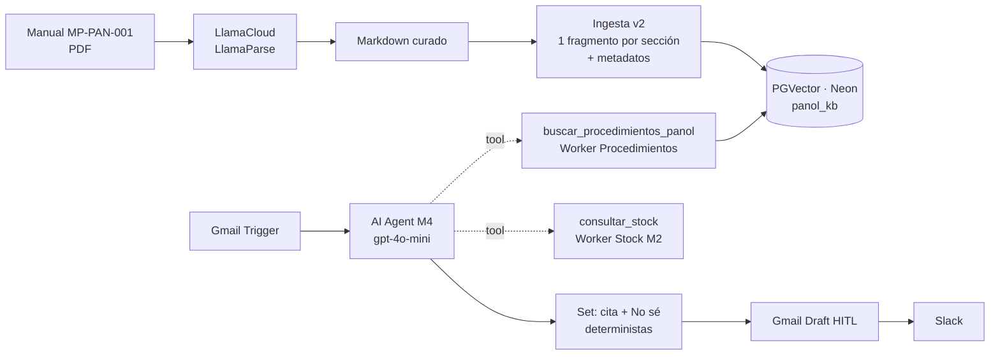

# Asistente de Pañol: Proyecto Integrador · Checkpoint M5

**Curso IA Avanzada (n8n) · Módulo 5: El Cerebro Documental de la IA (RAG)**
Autor: Mario Suarez · Entregable: [`PreEntrega_Modulo5_MarioSuarez.pdf`](./PreEntrega_Modulo5_MarioSuarez.pdf)
Base: Checkpoint [M4](../M4) (canal Email + HubSpot + Slack), al que se suma la base de conocimiento documental

---

## 1. Resumen

El agente del M4 sabía **cuánto hay y dónde está** un repuesto. Ahora también responde **cómo se pide, quién lo aprueba y qué reglas aplican**, consultando el *Manual de Procedimientos del Pañol (MP-PAN-001)*. Cita la sección de la que sale cada respuesta y responde **"No sé"** cuando el dato no figura en el manual.

| Indicador | Valor |
|---|---|
| Documento indexado | MP-PAN-001 Rev. 03 · 13 secciones · 9 tablas |
| Fragmentos | 20 (uno por sección o subsección) |
| Recuperación | Top-K 3 · Minimum Score 0,66 · zona gris 0,60 |
| Exactitud (5 preguntas ciegas) | 60 % en la batería inicial → **100 % en la regresión final** |
| Alucinaciones en la regresión final | 0 |

## 2. Arquitectura

> **Decisión de diseño:** en el plan gratuito de LlamaCloud, las carpetas e índices (Index v2) requieren plan Starter. LlamaCloud se usa como **parser y Data Source** (LlamaParse), y el índice vectorial vive en **PGVector sobre Neon**, como en el JSON de ejemplo del curso. Un sub-workflow cumple el rol de *Vector Store Retrieve Tool* y suma lo que el nodo nativo no expone: **Minimum Score** y **cita desde metadatos**.

## 3. Archivos

| Archivo | Contenido |
|---|---|
| `PreEntrega_Modulo5_MarioSuarez.pdf` | Entregable con las 5 piezas de la rúbrica |
| `checkpoint5_mario_suarez.json` | Workflow principal: canal Email del M4 + herramienta RAG + System Prompt RAG |
| `worker_procedimientos_panol_m5.json` | Sub-workflow de búsqueda: Top-K, Minimum Score escalonado y contrato con cita |
| `ingesta_procedimientos_panol_m5_v2.json` | Carga y reemplazo (overwrite) del documento en `panol_kb` |
| `calibracion_minimum_score_m5.json` | Calibración del umbral con 8 consultas de control |
| `setup_neon_panol_kb.sql` | Extensión `vector` y tabla `panol_kb` |
| `docs/` | Manual en PDF (fuente) y Markdown curado (lo que se indexa) |

## 4. Recuperación: Top-K y Minimum Score

| Similitud del mejor fragmento | Estado del Worker | Comportamiento |
|---|---|---|
| ≥ 0,66 | `ok` | Pasan los fragmentos sobre el umbral |
| 0,60 – 0,66 | `ok_confianza_media` | Pasa solo el #1; el agente verifica la evidencia |
| < 0,60 | `no_match` | "No sé" sin costo de LLM |

- **Top-K 3:** en dos casos la respuesta correcta quedó 2.ª detrás de un fragmento parecido.
- **0,66:** punto medio entre las respuestas correctas (≥ 0,685) y el ruido (≤ 0,642) en la calibración.
- **Zona gris:** la similitud de una misma pregunta varía hasta ±0,07 según la reformulación.

## 5. Contención de alucinaciones (4 capas)

1. **Umbral escalonado** en el Worker.
2. **Evidencia obligatoria:** `dato_solicitado` + `evidencia` literal (System Prompt + esquema JSON).
3. **Cita sin evidencia → "No sé"**, forzado por código en el Set.
4. **El texto admite no saber → "No sé" oficial**, normalizado por código, con revisión humana.

La **cita** `[Manual: … · Rev. 03 · Secc. X]` la arma el Worker desde los metadatos y la inserta el Set: el modelo no puede inventar la fuente.

## 6. Validación

| Iteración | Cambio | Exactitud |
|---|---|---|
| 0 | Batería ciega inicial | 3/5 |
| 1 | Fragmentos por sección, cita determinista, jerga a cifras | 4/4 re-testeadas |
| 2 | Regresión completa: se detectó una prohibición convertida en condicional (P4) | 4/5 |
| 3 | Zona gris + esquema estricto: se detectó una alucinación con cita real (P5) | 4/5 |
| 4 | Evidencia obligatoria + "No sé" por código | **5/5** |

**Lecciones:**
- Después de cada cambio se re-corre la batería **completa**.
- Un umbral solo no frena las alucinaciones cuando la pregunta nombra una entidad del manual.
- Lo que es cumplimiento (la cita y el "No sé") se garantiza por código, no por prompt.

## 7. Gobernanza (resumen)

- **Responsable del contenido:** Responsable de Pañol. **Aprueba:** Jefe de Mantenimiento. **Opera la base:** Asesor IA.
- **Frecuencia:** re-ingesta ante cada revisión, revisión trimestral fija y revisión mensual del log (`no_match`, `ok_confianza_media`).
- **Reemplazo:** formulario de ingesta con overwrite por `doc_code`, seguido de la calibración y la batería de 5 preguntas (criterio: 5/5, 0 alucinaciones).
- **Eliminación:** documentos derogados, duplicados o con formato que el parser no estructura bien.
- **Cambio de modelo de embeddings:** re-indexar todo y recalibrar el umbral.

## 8. Puesta en marcha

1. Ejecutar `setup_neon_panol_kb.sql` en la base de Neon.
2. Crear las credenciales:
   - **Postgres (Neon)**;
   - **Google Gemini (PaLM) API**, con dominio restringido a `generativelanguage.googleapis.com`.
3. Importar los workflows y asignar las credenciales. Embeddings: `models/gemini-embedding-001`, igual en la ingesta, el Worker y la calibración.
4. Ejecutar la **Ingesta v2** con `docs/Manual_Procedimientos_Panol_MP-PAN-001_curado.md`, código `MP-PAN-001` y revisión `03`. Resultado esperado: 20 fragmentos.
5. **Publicar** el Worker. El agente solo puede llamar a la versión publicada.
6. En el workflow principal, reseleccionar el Worker en `buscar_procedimientos_panol` (*From list*) y verificar sus *Workflow Inputs*. Reasignar las credenciales del M4.

> El JSON no contiene secretos: n8n exporta solo referencias a las credenciales. El manual es un documento de ejemplo con valores de referencia; no refleja datos reales de la empresa.
