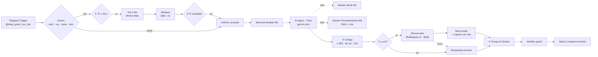

# Asistente de Pañol: Proyecto Integrador · Checkpoint M6

**Curso IA Avanzada (n8n) · Módulo 6: Ecosistemas Multimedia de Audio (Voice AI)**
Autor: Mario Suarez · Entregable: [`PreEntrega_Modulo6_MarioSuarez.pdf`](./PreEntrega_Modulo6_MarioSuarez.pdf)
Base: Checkpoint [M5](../M5) (agente RAG con stock y procedimientos), al que se suma un **Canal Voz** por Telegram

---

## 1. Resumen

El agente del M5 respondía stock y procedimientos con cita del manual, pero solo por texto. El M6 le agrega **oídos** (OpenAI Whisper) y **voz** (ElevenLabs) en un canal propio de Telegram, pensado para el técnico de mantenimiento que consulta desde la planta con las manos ocupadas. El agente, sus tools y la memoria se reutilizan sin cambios.

| Indicador | Valor |
|---|---|
| Componentes de la rúbrica | 8/8 implementados y evidenciados |
| Pruebas obligatorias | 10/10 aprobadas (P1–P5, P7–P11) |
| Caracteres por audio | ≤ 200, por System Prompt + código |
| Latencia percibida | 10,6 s (texto) · 14,7–21,9 s (voz) |
| Costo estimado | ≈ USD 0,02 por interacción de voz |
| Persistencia del audio | 0 ejecuciones y 0 binarios en disco (verificado) |

## 2. Arquitectura

## 3. Archivos

| Archivo | Contenido |
|---|---|
| `PreEntrega_Modulo6_MarioSuarez.pdf` | Entregable con capturas de la configuración visual: los 8 componentes, pruebas, latencia, costos, hallazgos y compliance |
| `checkpoint6_mario_suarez.json` | Workflow "Canal Voz" exportado de n8n 2.26.7 |
| `nodo3_contencion_voz_v3.js` | Código del nodo ③ (incluido en el JSON), para lectura |

## 4. Componentes de la rúbrica

| Componente | Implementación |
|---|---|
| Interceptación binaria | Telegram Trigger (bot oficial vía @BotFather) + Get a file → binario `data` |
| Oídos | OpenAI · Transcribe a Recording · Input Binary Property `data` · Language `es` |
| Cerebro | AI Agent en modo Tools Agent + Worker Stock (M2) + Worker Procedimientos RAG (M5) + parser JSON con Auto-Fix |
| Contención financiera | System Message: "MÁXIMO DE 200 CARACTERES"; nodo ③: tope duro, normalización para la voz, resumen de listados |
| Voz | ElevenLabs (nodo verificado) · Eleven Multilingual v2 · voz Bella · Stability 0,50 · Clarity/Similarity 0,80 |
| Salida binaria | Telegram Send Audio con el binario de ElevenLabs + caption (código SAP, material, cita) |
| Contingencia | IF de duración, IF de audio inaudible, error de Whisper, error del agente, error de ElevenLabs → texto, escalada a Slack |
| Compliance | Ejecuciones no guardadas (éxito, error, manuales) · Set sin binario · memoria sin audio · aviso de privacidad en /start |

## 5. Hallazgos principales

| # | Hallazgo | Corrección |
|---|---|---|
| H3 | Voz de la Voice Library bloqueada por API en el plan Free (402) | Voz predeterminada; la contingencia entregó la respuesta en texto |
| H5 | El modelo respondió en prosa y el parser forzó 6 vueltas (63 s, 33.000 tokens) | Auto-Fix Format + regla de formato: 5.800 tokens (−82 %) |
| H6 | Audio cortado en "3." de una lista | Corte en punto real y resumen de listados por código |
| H8 | Errores fonéticos de Whisper con nombres alfanuméricos | Material tomado del dato oficial del stock; límite documentado |
| H9 | n8n guarda las ejecuciones canceladas aunque la configuración diga "Do not save" | Borrado y revisión en el procedimiento; límite de antigüedad en servidor |

El detalle de H1–H9 está en la sección 11 del PDF.

## 6. Puesta en marcha

1. Crear un bot con @BotFather (uno exclusivo: Telegram admite un solo webhook por bot) y la credencial **Telegram API**.
2. Credencial **OpenAI** con saldo cargado (Whisper no funciona sin crédito) y dominio restringido a `api.openai.com`.
3. Instalar el nodo verificado `@elevenlabs/n8n-nodes-elevenlabs` y crear la credencial **ElevenLabs API**: clave restringida a Text to Speech + lectura de voces y modelos, con tope de créditos.
4. Importar `checkpoint6_mario_suarez.json`, asignar credenciales (también a los nodos de contingencia) y reseleccionar los Workers del M2/M5 con *From list*, verificando sus *Workflow Inputs*.
5. En el nodo ElevenLabs, elegir una **voz predeterminada**: las de la Voice Library requieren plan pago para usarse por API.
6. Verificar los **Settings** (n8n no los conserva al importar): las tres opciones de guardado de ejecuciones en *Do not save*, timeout de 120 s y zona horaria explícita.
7. Exponer n8n por HTTPS (`WEBHOOK_URL`) y publicar el workflow.

> El JSON no contiene secretos: n8n exporta solo referencias a las credenciales. Los datos de stock y el manual son de ejemplo, con valores de referencia.
