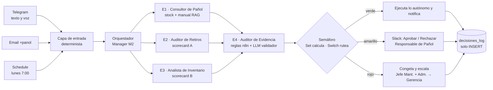

# Asistente de Pañol: Proyecto Integrador · Pre-entrega M7

**Curso IA Avanzada (n8n) · Módulo 7: Arquitectura Agéntica Empresarial**
Autor: Mario Suarez · Entregable: [`PreEntrega_Modulo7_MarioSuarez.pdf`](./PreEntrega_Modulo7_MarioSuarez.pdf)
Base: Checkpoint [M6](../M6) (agente de consultas con stock, RAG del manual y canal de voz), especializado en una red de agentes para una vertical de industria

---

## 1. Resumen

Esta pre-entrega es un **documento de diseño** (no un workflow nuevo): un informe de consultoría que especializa el Asistente de Pañol en un sistema multi-agente para la vertical **Operaciones de Mantenimiento (MRO) en manufactura de pinturas**. Hasta el M6 el asistente era reactivo (responde consultas); el diseño suma control de retiros e higiene de inventario bajo una regla simple: **la IA interpreta, las reglas deciden el color del semáforo y una persona aprueba todo lo que mueve dinero o puede parar una línea**.

| Indicador | Valor |
|---|---|
| Componentes de la consigna | 4/4 (relevamiento, arquitectura, valor y semáforo, scorecards y portafolio) + matriz de cumplimiento |
| Red de agentes | Orquestador + 4 especialistas (E1 Consultor · E2 Auditor de Retiros · E3 Analista de Inventario · E4 Auditor de Evidencia) |
| Proceso priorizado | Control de retiros (4,4 / 5) e higiene de inventario (4,2 / 5) |
| Baseline | ≈ 98 h/mes de trabajo administrativo del pañol |
| Metas a 6 meses | 100 % de retiros trazables · −50 % de quiebres de críticos A · ≥ 30 h/mes liberadas |
| Enfoque | 100 % no-code: los cálculos exactos se resuelven con nodos nativos de n8n |

## 2. Arquitectura propuesta

## 3. Contenido del informe

| Sección | Componente de la consigna | Contenido |
|---|---|---|
| 01 | Relevamiento y priorización | Problema operativo, justificación agéntica, framework de 4 vectores con 5 procesos candidatos, traducción económica del impacto y baseline |
| 02 | Arquitectura y permisos | Diagrama de coreografía, ficha por agente (misión, System Prompt, tools, JSON), context engineering por sub-workflow y mapa de permisos de mínimo privilegio |
| 03 | Propuesta de valor y semáforo | Propuesta en lenguaje comercial, 8 KPIs con fórmula, baseline, meta y fuente, semáforo de autonomía y protocolo de escalado en 3 niveles con fail-safe |
| 04 | Scorecards y portafolio | Scorecard de riesgo de retiro, scorecard de higiene de inventario, rúbrica de evidencia, normalización por tags, reporte narrativo de ejemplo y versión de portafolio anonimizada |
| Anexo | Cumplimiento | Matriz requisito → sección |

## 4. Decisiones de diseño principales

| Decisión | Motivo |
|---|---|
| El puntaje y el color del semáforo los calculan reglas n8n, no el modelo | Resultado reproducible y auditable; el LLM solo puntúa criterios que exigen leer texto, siempre con cita |
| Los agentes no tienen tools de escritura en sistemas de negocio | Mínimo privilegio: escribe solo la capa determinista, después del semáforo, y nunca en SAP |
| Validador de evidencia antes de toda salida (Generador + Validador) | Ninguna afirmación sin respaldo llega al usuario ni a un aprobador |
| HITL con *Send and Wait* en Slack, plazos y estado `expirado` | Sin respuesta, la acción no se ejecuta |
| Registro de decisiones inmutable (rol Postgres solo INSERT) | Trazabilidad completa: quién pidió, quién aprobó y por qué |

## 5. Archivos

| Archivo | Contenido |
|---|---|
| `PreEntrega_Modulo7_MarioSuarez.pdf` | Informe de consultoría (13 páginas) |

> Pre-entrega de diseño: no incluye un workflow nuevo. Los datos operativos son valores de referencia del área; el baseline real se medirá durante 2 semanas antes de implementar.
