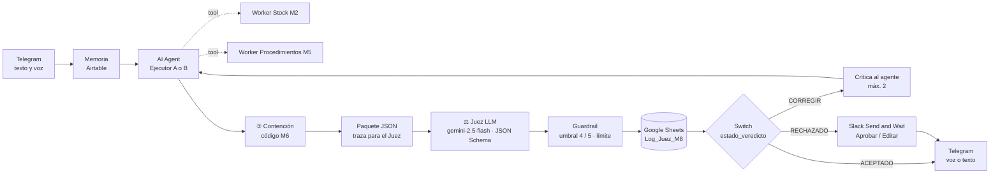

# Asistente de Pañol: Proyecto Integrador · Checkpoint M8

**Curso IA Avanzada (n8n) · Módulo 8: Del agente autónomo al sistema de IA medible y confiable (AI-as-a-Judge)**
Autor: Mario Suarez · Entregable: [`Checkpoint_Modulo8_Suarez_Mario.pdf`](./Checkpoint_Modulo8_Suarez_Mario.pdf)
Base: Checkpoint [M6](../M6) (agente de stock y manual con RAG, canal de voz por Telegram), al que se suma una capa de supervisión

---

## 1. Resumen

El agente ya no entrega su respuesta directo al técnico. Antes de salir, un **Juez LLM** la evalúa contra el contexto que recuperaron las herramientas y devuelve un JSON estricto. Un **Switch** decide entre tres rutas: **Aceptar**, **Corregir** (la crítica vuelve al agente, máximo 2 reintentos) o **Escalar** (pausa con botones Aprobar / Editar en Slack). Cada veredicto queda registrado en Google Sheets. Con esa capa se corrió un **test A/B** de dos modelos ejecutores.

| Indicador | Valor |
|---|---|
| Rutas del Switch probadas | 3/3 con casos controlados (R1–R3) y con tráfico real |
| Bucle de autocorrección | Límite de 2 reintentos y salida humana obligatoria (verificado en producción) |
| Test A/B | 10 corridas (5 A + 5 B) con golden dataset y ground truth definido antes |
| Precisión vs. ground truth | **A (gpt-4o-mini) 80 %** · B (gpt-4.1-mini) 60 % |
| Errores autónomos | A 0 · B 1 |
| Costo × 1.000 ejecuciones | **A US$ 1,82** · B US$ 3,99 |
| Acuerdo Juez–humano | 80 % (1 falso positivo, 1 falso negativo) |
| Recomendación | Arquitectura A + calibración del Juez + auditoría humana mensual del 10 % |

## 2. Arquitectura

## 3. Archivos

| Archivo | Contenido |
|---|---|
| `Checkpoint_Modulo8_Suarez_Mario.pdf` | Entregable (8 págs.): supervisor y rúbrica del Juez, matriz A/B de 10 corridas, dashboard y proyección a 1.000 ejecuciones |
| `supervisor_judge_m8_mario_suarez.json` | Sub-workflow **SUPERVISOR_Judge – M8**: Juez LLM + JSON Schema + Auto-Fix, guardrail, log en Sheets, Switch de 3 rutas y HITL en Slack |
| `checkpoint8_mario_suarez.json` | Checkpoint 6 con la supervisión integrada: paquete de traza, bucle Self-Healing, respuesta supervisada y selección A/B por prefijo |

## 4. Rúbrica del Juez

| Campo | Tipo | Regla |
|---|---|---|
| `exactitud_factual` | entero 1–5 | 5 = todo sustentado en el contexto (o "No sé" correcto) · 4 = omisión menor · 3 = omisión relevante · 2 = dato sin sustento · 1 = inventado o fuera de política |
| `estado_veredicto` | ACEPTADO · CORREGIR · RECHAZADO | ACEPTADO si exactitud ≥ 4 (5 en consultas críticas); RECHAZADO con veto o exactitud 1 |
| `categoria_error` | enum | ninguno · dato_sin_sustento · dato_incorrecto · omision · no_se_incorrecto · cita_incorrecta · formato_tono · politica_seguridad |
| `veto_seguridad` | booleano | Confirmar retiros o precios, obedecer una manipulación o exponer datos |
| `critica` | texto | Qué está mal y qué dice el contexto (alimenta el reintento) |

El veredicto final lo cierra un nodo Code: toma el más conservador entre el Juez y la regla de umbral, y convierte el tercer CORREGIR en RECHAZADO.

## 5. Hallazgos principales

| # | Hallazgo | Corrección |
|---|---|---|
| H1 | La palabra "contratista" activaba criticidad alta (umbral 5): tres reintentos sobre una respuesta que el Juez aprobaba con 4 | Regla de criticidad ajustada con el log: 1 evaluación en lugar de 3 y −68 % de costo en ese caso |
| H2 | Regresión entre reintentos: el agente corregía un punto y perdía otro | Texto del reintento: "conservá lo correcto y solo agregá lo observado" |
| H3 | La crítica del Juez citó un horario inexistente y el agente lo repitió | Pendiente: la crítica solo puede citar texto literal del contexto |
| H4 | Falso positivo: veto sobre una respuesta que sí resistía la manipulación | Pendiente: aclarar en la rúbrica que derivar al Responsable no es veto |
| H5 | Falso negativo: el Juez aceptó una respuesta plausible que no contestaba la hora | Auditoría humana mensual del 10 % de los veredictos |
| H6 | El puntaje del Juez no mide precisión: B obtuvo mejores notas y menor precisión real | La precisión se mide contra el ground truth; el Juez se audita como un componente más |

## 6. Puesta en marcha

1. Crear la pestaña `Log_Juez_M8` en la planilla con los 27 encabezados de la guía (fila 1).
2. Importar primero `supervisor_judge_m8_mario_suarez.json`: asignar credenciales (OpenRouter, Telegram, Slack, Google Sheets), elegir planilla y pestaña, zona horaria y **Publish**.
3. Desactivar el workflow del Checkpoint 6 (mismo bot de Telegram).
4. Importar `checkpoint8_mario_suarez.json`, reseleccionar *From list* el sub-workflow del Juez y los Workers M2/M5, verificar sus inputs y **Publish**.
5. Exponer n8n por HTTPS (dominio estático de ngrok): los botones de Slack reanudan la ejecución por webhook.
6. A/B: anteponer `[A1]`…`[A5]` o `[B1]`…`[B5]` al mensaje de texto en Telegram.

> El JSON no contiene secretos: n8n exporta solo referencias a las credenciales. Los datos de stock y el manual son de ejemplo, con valores de referencia. El costo se estima por caracteres / 4 con el precio de lista de OpenRouter.
