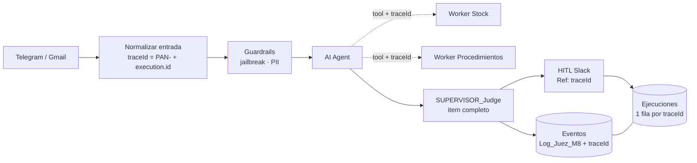

# Asistente de Pañol: Proyecto Integrador · Pre-entrega M9

**Curso IA Avanzada (n8n) · Módulo 9: Plan de Gobernanza, Gestión y Monitoreo Financiero de IA**
Autor: Mario Suarez · Entregable: [`PreEntrega_Modulo9_MarioSuarez.pdf`](./PreEntrega_Modulo9_MarioSuarez.pdf)
Base: Checkpoint [M8](../M8) (agente con supervisor AI-as-a-Judge y dashboard A/B), al que se suma el plan de gestión para llevarlo a producción

---

## 1. Resumen

El sistema que se gobierna es el del Módulo 8. Responde consultas de stock y de procedimientos del pañol por Telegram (texto y voz) y por email, y un Juez LLM audita cada respuesta antes de entregarla. Partiendo del costo medido en ese checkpoint (US$ 1,82 cada 1.000 ejecuciones), el plan cubre las tres dimensiones de la consigna: finanzas, trazabilidad y gobernanza.

| Indicador | Valor |
|---|---|
| Baseline manual | 550 consultas/mes = 36,3 h hombre |
| Horas recuperadas | 25,4 h/mes (KPI 2) |
| Resolución autónoma | 60 % medido en el M8 · meta ≥ 75 % con el Juez calibrado (KPI 1) |
| Satisfacción (CSAT) | Se mide desde el piloto con calificación 👍/👎 en Telegram (KPI 3) |
| TCO mensual | US$ 124,8 (IA US$ 2,76 = 2,2 % del total) |
| ROI operativo | 130 % base · 63 % conservador · 92 % con tokens × 10 |
| Payback de la puesta en marcha | 3,8 meses |
| Llaves de API | DEV con tope de US$ 5/mes (bloqueante) · PROD con tope de US$ 10/mes y alertas al 70 % y 90 % |
| Trazabilidad | `traceId = "PAN-" + $execution.id`, propagado a Workers, Juez, HITL y log |
| Riesgos documentados | 5: sesgo, alucinación, prompt injection, privacidad y acceso excesivo |

## 2. Contenido del PDF (9 páginas)

| Dimensión | Peso | Contenido |
|---|---|---|
| 1 · Planificación financiera y economía del token | 35 % | 3 KPIs, baseline y ROI por tarea automatizada, sensibilidad y picos de demanda, matriz TCO con presupuesto de tokens, análisis de Prompt Caching (5 opciones), separación de llaves DEV/PROD con tope |
| 2 · Logs estructurados y trazabilidad | 35 % | Base relacional `Ejecuciones` 1–N `Eventos` (reutiliza `Log_Juez_M8` + columna `traceId`), recorrido del traceId por los sub-workflows, JSON Schema del log, ejemplo correlacionado y dashboard por traceId |
| 3 · Gobernanza ética, ciberseguridad y compliance | 30 % | Reglas de objetividad del System Prompt, mapa de 5 riesgos con control y ubicación, barreras en el lienzo, configuración por proveedor que evita el entrenamiento (dónde se verifica y a qué área consultar) |
| Cierre | — | Recomendación y matriz de cumplimiento contra la consigna y los criterios de evaluación |

## 3. Propagación del traceId

## 4. Esquema del log (campos obligatorios)

| Campo | Contenido |
|---|---|
| `timestamp` | ISO 8601, zona America/Argentina/Buenos_Aires |
| `traceId` | Clave de correlación sin datos personales |
| `nodeName` | Nodo que decidió o falló |
| `toolOutput` | Resumen de los pasos intermedios, truncado y sanitizado de PII |
| `systemPromptSnapshot` | Referencia versionada (`agente_rag_v4`, `juez_v1.1`) |
| `confidenceScore` | `exactitud_factual ÷ 5` del Juez o `confidence` del Manager; `null` si no hay un método válido |

## 5. Privacidad por proveedor

| Proveedor | Configuración | Dónde se verifica |
|---|---|---|
| OpenRouter (agente, Juez, Email) | Zero Data Retention por grupo de modelos y prompt logging apagado | openrouter.ai/settings/privacy |
| OpenAI (Whisper) | Sin entrenamiento por defecto; ZDR a solicitar para producción | Settings → Organization → Data controls |
| Google Gemini (embeddings) | Pasar a plan pago: el gratuito puede usar los datos para mejorar productos | ai.google.dev/gemini-api/terms |
| ElevenLabs (voz) | Recibe solo el texto validado y sanitizado | Política de privacidad de la cuenta |

Áreas a consultar en un despliegue real: **Sistemas** (configuración y verificación) y **Legal** (DPA y transferencia internacional, Ley 25.326).

> Los valores marcados en el PDF como **MEDIDO** provienen del A/B del M8. Los marcados como **SUPUESTO** se validan en el piloto. Los marcados como **DISEÑO** son configuraciones propuestas que todavía no se capturaron en ejecución. Las tarifas se consultaron el 13/10/2026.
